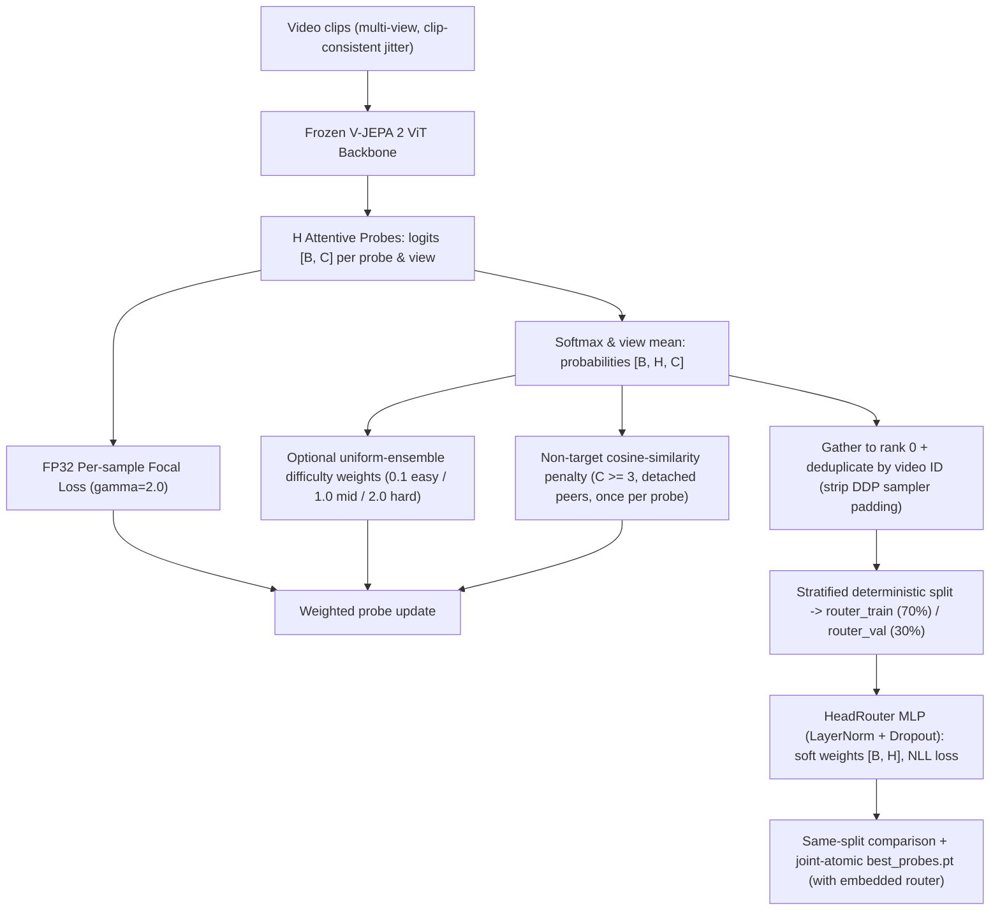

# Per-Video Classifier Routing for V-JEPA 2

> A drop-in overlay on Meta's frozen V-JEPA 2 video classifier that replaces "keep the single best probe" with per-video routing across all probes.

[](https://github.com/zeweijin86-hub/vjepa2-router/actions/workflows/tests.yml)
[](LICENSE)
[](https://github.com/facebookresearch/vjepa2)

**Status:** research prototype · unit-tested on CPU · patch pinned to upstream `204698b4` · an overlay, not a fork

This repository is a minimal, self-contained overlay on top of Meta's frozen [V-JEPA 2](https://github.com/facebookresearch/vjepa2) video-classification evaluator (`evals/video_classification_frozen/eval.py`). Instead of training `H` independent attentive probes and retaining only the single highest-scoring head, this extension combines:

* **FP32-safe Focal Loss with optional dynamic difficulty weighting** (`focal_gamma`, `use_difficulty_weighting`) to concentrate probe capacity on misclassified and low-confidence clips.
* **Non-target inter-probe diversity regularization** (for multiclass tasks with `C >= 3`) against detached peers, keeping per-probe DDP autograd graphs independent without conflicting with ground-truth supervision.
* **Per-video probability-level stacking router (`HeadRouter`)** trained with exact mixture negative log-likelihood on deduplicated, stratified validation splits, with joint-atomic `best_probes.pt` checkpointing, read-only `--val_only` evaluation, and distributed `--infer_only` inference.

## 30-second quickstart

`router.py` and `losses.py` depend only on PyTorch, so the router can be used without checking out upstream V-JEPA 2:

```python
import torch
from evals.video_classification_frozen.router import HeadRouter

probs = torch.randn(4, 20, 2).softmax(dim=-1)   # [B, H, C] per-probe probabilities
router = HeadRouter(num_heads=20, num_classes=2).eval()
with torch.no_grad():
    weights = router(probs)                                # [B, H] per-video head weights
    fused = (probs * weights.unsqueeze(-1)).sum(dim=1)     # [B, C] routed probabilities
```

```bash
python -m unittest discover -s tests -v
```

## Data Flow



## Results

A quantitative comparison on a held-out manifest is in progress and will be filled in only after it is measured with the `--val_only` path on data that was never used for epoch selection.

| Dataset | Classes | Probes | Best single probe | Uniform ensemble | HeadRouter |
| --- | --- | --- | --- | --- | --- |
| _pending_ | | | | | |

All three columns are computed on the identical `router_val` split, so the comparison is apples-to-apples by construction rather than by luck of the split.

## Key Design Decisions & Scope

* **Zero-leakage multi-GPU gathering & same-split comparison**: `DistributedSampler(drop_last=False)` pads datasets whose length is not divisible by `world_size` by repeating leading samples. Validation gathers predictions to `rank == 0` via `dist.gather_object`, deduplicates by video identifier, sorts deterministically, and performs a **stratified** 70%/30% split with isolated RNG seeding (`torch.random.fork_rng`). `router_acc`, `best_probe_acc`, and `uniform_ens_acc` are all evaluated on the exact same `router_val` split so gains are directly comparable. Because epoch selection takes the max over `num_epochs` on `router_val`, final performance should always be reported on a separate held-out test manifest via `--val_only` (pure forward evaluation) or `--infer_only`.
* **Non-target diversity regularization (`C >= 3` only)**: On a binary simplex (`C = 2`), probabilities have only 1 degree of freedom (`p_1 = 1 - p_0`), so minimizing full-vector cosine similarity pushes probes toward the wrong class. `differentiable_diversity_loss` masks out the ground-truth class `y`, filters saturated zero-norm non-target vectors to keep backward gradients finite, and automatically no-ops when `C <= 2`.
* **Clip-consistent color jitter**: `VideoTransform` samples `ColorJitter` parameters once per clip via `ColorJitter.get_params` and applies them uniformly across all frames, preserving temporal continuity for V-JEPA 2's frozen `tubelet_size=2` 3D patch embedding.
* **Configurable Focal + difficulty weighting**: Combining Focal Loss (`gamma=2.0`) with dynamic difficulty weights (`0.1` / `2.0`) strongly focuses gradients on hard/misclassified samples and assumes relatively clean labels. For noisy datasets, disable `use_difficulty_weighting: false` or lower `focal_gamma`.
* **Probability-level stacking scope**: `HeadRouter` maps flattened probe probabilities `[B, H * C]` through a `LayerNorm` MLP (safe down to `batch_size = 1`) trained with AdamW + cosine LR decay on exact mixture NLL (`F.nll_loss(log(sum_h w_h p_h), y)`). This is compact for low-to-moderate class counts; for high-cardinality datasets (e.g., Kinetics-400), replacing raw `[B, H, C]` inputs with per-head summary features (top-k probabilities, entropy, margin) is recommended.
* **Joint-atomic checkpointing, leak-free `--val_only`, and deadlock-free `--infer_only`**: `run_one_epoch` never writes checkpoints directly. Whenever `router_val` improves during training, lightweight probe weights (without optimizer states) and the matched router state dict are saved together inside `best_probes.pt` via a single atomic `os.replace` (alongside an epoch-tagged `router.pt` export). `--val_only` loads the saved router and runs pure forward evaluation on the deduplicated manifest without refitting or overwriting checkpoints/CSV logs. `--infer_only` skips training setup, requires a checkpoint, checks full manifest coverage (broadcasting any missing-video error to all ranks before `dist.barrier()` to prevent NCCL deadlocks), and atomically writes `predictions.txt`.

## File Map

| File | Status | Role & Key Changes |
|---|---|---|
| `evals/video_classification_frozen/router.py` | Added | Standalone `HeadRouter`, `evaluate_router`, `train_and_eval_router`, `stratified_train_val_split`, `compute_difficulty_weights`, non-target `differentiable_diversity_loss`, and `deduplicate_by_name` (zero upstream dependencies). |
| `evals/video_classification_frozen/losses.py` | Added | Multiclass `FocalLoss` with FP32 promotion under AMP, optional class weights, and `reduction` validation. |
| `evals/video_classification_frozen/eval.py` | Modified | Integrates `FocalLoss`, optional difficulty weighting, non-target diversity, deduplicated rank-0 gathering, same-split CSV logging, joint-atomic `best_probes.pt` + epoch-tagged `router.pt`, pure-forward `--val_only`, and deadlock-free coverage-checked `--infer_only`. |
| `evals/video_classification_frozen/utils.py` | Modified | Adds configurable clip-consistent `color_jitter` during training augmentation. |
| `src/datasets/video_dataset.py` | Modified | Reads CSV manifests (`video_path,category`), resolves relative paths against the CSV directory, and consistently returns 4-tuples `(buffer, label, clip_indices, name)`. |
| `evals/main.py` | Modified | Adds `--infer_only` CLI flag forwarding to the frozen evaluator. |
| `configs/eval/vitl/vitl_router.yaml` | Added | Example ViT-L configuration with 20 attentive probes and explicit loss/augmentation flags. |
| `tests/test_router_and_losses.py` | Added | Unit tests for `FocalLoss`, `HeadRouter`, `evaluate_router`, stratified splits, non-target/saturated diversity gradients, difficulty weighting, and DDP deduplication. |
| `patches/eval_modifications.patch` | Added | Unified diff against upstream `evals/video_classification_frozen/eval.py` (commit `204698b4`). |

## Integration & Usage

Apply this overlay on top of an upstream checkout of [`facebookresearch/vjepa2`](https://github.com/facebookresearch/vjepa2):

```bash
overlay="$PWD"
git clone https://github.com/facebookresearch/vjepa2.git ../vjepa2-base
cd ../vjepa2-base
git checkout 204698b45b3712590f06245fbfba32d3be539812
cp -R "$overlay/evals/." evals/
cp -R "$overlay/src/." src/
cp -R "$overlay/configs/." configs/
python -m pip install -r "$overlay/requirements.txt"
```

Update `model_kwargs.checkpoint`, `experiment.data.dataset_train`, and `experiment.data.dataset_val` in `configs/eval/vitl/vitl_router.yaml` to point to a ViT-L backbone checkpoint and CSV manifests (`video_path,category` with zero-based class IDs; relative paths are resolved from the CSV directory), then run:

```bash
# Train attentive probes and fit HeadRouter
python -m evals.main --fname configs/eval/vitl/vitl_router.yaml --devices cuda:0

# Pure forward evaluation on a labeled validation or held-out test manifest using saved router
python -m evals.main --fname configs/eval/vitl/vitl_router.yaml --devices cuda:0 --val_only

# Run distributed inference using synchronized best_probes.pt + embedded router
python -m evals.main --fname configs/eval/vitl/vitl_router.yaml --devices cuda:0 --infer_only
```

**Standalone use.** See the [30-second quickstart](#30-second-quickstart). `router.py` and `losses.py` require only PyTorch, so both the router and the test suite run without cloning upstream `vjepa2`; CI runs them on Python 3.10–3.12 against CPU-only PyTorch.

## Attribution & License

The frozen video encoder, attentive probe architecture, and base evaluation loop originate from [facebookresearch/vjepa2](https://github.com/facebookresearch/vjepa2). Modified upstream source files retain Meta Platforms' original copyright notice under the [MIT License](LICENSE).

`LICENSE` carries Meta's notice because it covers those upstream-derived files. Files added by this overlay — `evals/video_classification_frozen/router.py`, `losses.py`, `tests/`, `configs/eval/vitl/vitl_router.yaml`, and `patches/` — are released under the same MIT terms, © 2026 Zewei Jin.
